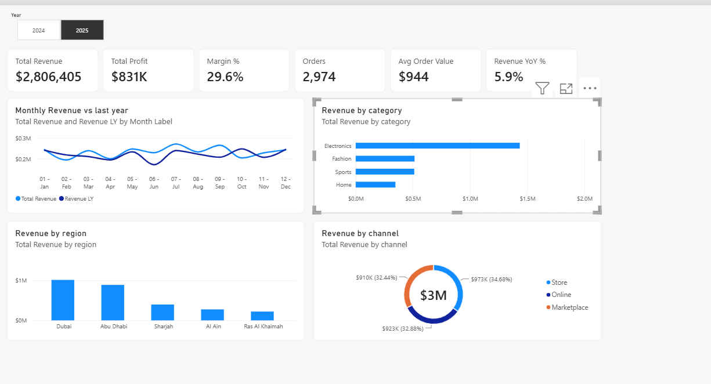
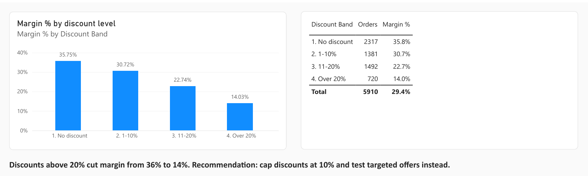

# Project 2 – Power BI Sales Performance Dashboard

Two-page interactive dashboard built in Power BI Desktop on a **synthetic** UAE retail sales dataset (5,910 clean orders, 20 products, 500 customers, 2024–2025). No real company data is used.

## Preview

**Sales Overview** (filtered to 2025)



**Discount Insight**



Files: [`Sales_Performance_Dashboard.pbix`](Sales_Performance_Dashboard.pbix) · [`Sales_Performance_Dashboard.pdf`](Sales_Performance_Dashboard.pdf)

## Key insights
- 2025 revenue was about **$2.81M**, up **5.9%** on 2024, with a **29.6%** profit margin.
- Dubai and Abu Dhabi lead on revenue, and Electronics is the largest category.
- Orders with **discounts above 20%** earn a **14.0%** margin, against **35.8%** with no discount.
- **Recommendation:** cap discounts at 10% and test targeted offers. The SQL project (Project 1) shows discounting did not raise order quantity.

## Data model
Star schema: `fact_sales` linked to `dim_products`, `dim_customers` and a `Date` table (one-to-many, single direction).

## Main DAX measures
```
Total Revenue = SUM(fact_sales[revenue])
Total Profit = SUM(fact_sales[profit])
Margin % = DIVIDE([Total Profit], [Total Revenue])
Orders = DISTINCTCOUNT(fact_sales[order_id])
Avg Order Value = DIVIDE([Total Revenue], [Orders])
Revenue LY = CALCULATE([Total Revenue], SAMEPERIODLASTYEAR('Date'[Date]))
Revenue YoY % = DIVIDE([Total Revenue] - [Revenue LY], [Revenue LY])
Revenue YTD = TOTALYTD([Total Revenue], 'Date'[Date])
Avg Discount % = AVERAGE(fact_sales[discount])
```
A calculated column, `Discount Band`, groups discounts into four levels using `SWITCH`.

## Skills shown
Data modelling · DAX · time intelligence · KPI design · dashboard layout · business storytelling

## Open it yourself
Open the `.pbix` in Power BI Desktop (free). If it asks for the data, point it to the CSV files in `data/clean` (Home → Transform data → Data source settings).
